# Laporan Praktikum 2: Web Server Express.js, Template Engine EJS, dan Pola Desain MVC

| | |
|---|---|
| **Nama** | Maria Stefania Misa |
| **NIM** | 42530037 |
| **Mata Kuliah** | Pemrograman Web (MK11) |
| **Modul** | Praktikum 2: Arsitektur Back-End (Monolith SSR) |
| **Semester** | Ganjil 2026/2027 |

---

## 1. Tujuan Praktikum

1. Menginisialisasi proyek Node.js dengan NPM dan menjalankan development server menggunakan nodemon.
2. Menyajikan berkas statis dan menangani rute yang tidak ditemukan (404) dengan middleware Express.
3. Menyisipkan data dinamis ke dalam berkas EJS dan menyusun antarmuka modular dengan EJS Partials.
4. Memecah aplikasi ke dalam struktur MVC (`routes/`, `controllers/`, `views/`) dengan `express.Router()`.
5. Menganalisis HTTP Request melalui DevTools, membaca data POST, dan menerapkan pola Post-Redirect-Get (PRG).

## 2. Lingkungan Praktikum

- Sistem operasi: macOS (MacBook Air)
- Editor: Visual Studio Code
- Runtime: Node.js v24.21.0, npm 11.19.0
- Peramban: Google Chrome (DevTools)
- Dependensi: `express`, `ejs`, dan `nodemon` (development dependency)

---

## 3. Hasil Pengalaman Laboratorium

### Pengalaman 1: Inisiasi Server dan Inspeksi Request-Response HTTP

**Langkah singkat:** membuat proyek `express-mvc-lab`, menjalankan `npm init -y`, memasang Express, EJS, dan nodemon, lalu membuat `app.js` dengan satu rute `GET /` pada port 3000. Server dijalankan dengan `npm run dev`.

**Hasil analisis DevTools (tab Network, request `localhost`):**

- **General:** Status Code `200 OK`, metode `GET`.
- **Response Headers:** `Content-Type: text/html; charset=utf-8` dan `X-Powered-By: Express`.
- **Request Headers:** berisi informasi dari browser seperti `Host`, `User-Agent`, dan `Accept`.

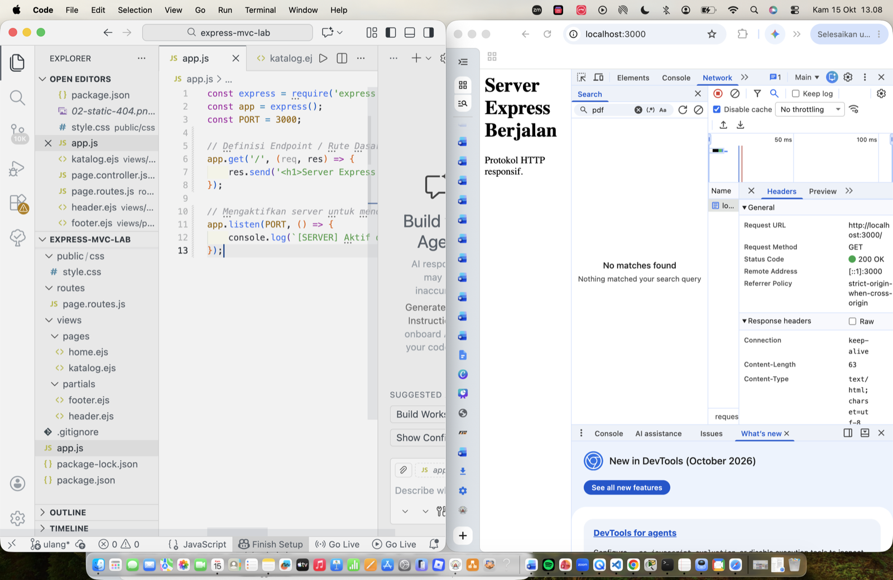

### Pengalaman 2: Aset Statis dan Analisis HTTP 404

**Langkah singkat:** menambahkan `app.use(express.static('public'))` agar folder `public` dapat diakses, memuat `style.css` lewat tag `<link>`, dan menambahkan middleware 404 di bagian akhir sebelum `app.listen`.

**Analisis:**

- Setelah middleware statis aktif, halaman memuat dua request: dokumen `localhost` dan `style.css`, keduanya berstatus `200 OK`.
- Mengakses `/rute-palsu` tidak cocok dengan rute atau berkas statis mana pun, sehingga jatuh ke middleware 404 dan menghasilkan status `404 Not Found`.
- Urutan middleware penting: handler 404 harus berada paling bawah agar tidak menangkap rute yang valid.

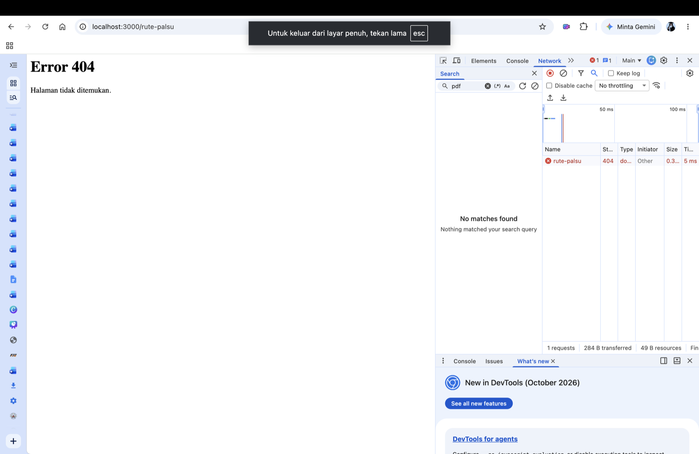

### Pengalaman 3: EJS Engine dan UI Partials

**Langkah singkat:** mendaftarkan `app.set('view engine', 'ejs')`, membuat `header.ejs` dan `footer.ejs` di `views/partials/`, lalu membuat `views/pages/home.ejs` yang memanggil keduanya dengan `include`. Data (`userName`, `fiturList`) dikirim lewat `res.render`.

**Analisis:**

- `<%= ... %>` mencetak data dengan escape HTML (aman dari XSS).
- `<% ... %>` menjalankan logika JavaScript (misalnya `forEach`) tanpa mencetak output.
- `<%- ... %>` mencetak HTML mentah, dipakai untuk `include` partial.
- Dengan partials, header dan footer cukup ditulis sekali dan dipakai ulang di semua halaman (prinsip DRY).

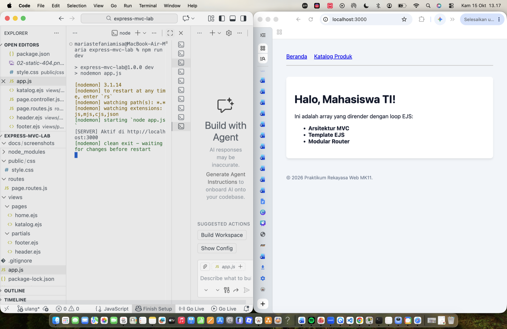

### Pengalaman 4: Refactoring Arsitektur MVC

**Langkah singkat:** logika dipisah menjadi tiga lapisan.

- **Controller** (`controllers/page.controller.js`): fungsi yang memproses request dan memanggil `res.render`.
- **Router** (`routes/page.routes.js`): memetakan metode HTTP dan URL ke fungsi controller memakai `express.Router()`.
- **View** (`views/pages/`): halaman EJS untuk tampilan.

`app.js` menjadi ringkas: hanya inisialisasi, middleware, pemasangan router, dan handler 404. Berkas `katalog.ejs` dibuat agar rute `/katalog` dapat dirender.

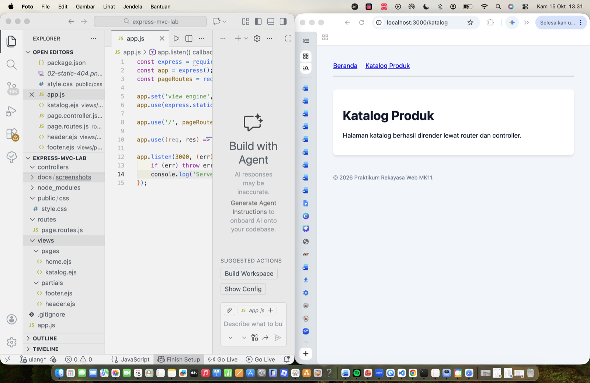

### Pengalaman 5: Payload HTTP POST dan Pola Redirect

**Langkah singkat:** menambahkan form `method="POST"` dengan input ber-atribut `name`, mengaktifkan `app.use(express.urlencoded({ extended: true }))`, lalu membuat `postTambahProduk` yang mencetak `req.body` dan melakukan `res.redirect('/katalog')`.

**Analisis:**

- Di tab Payload DevTools, data tampil dalam bentuk form-urlencoded, yaitu pasangan `namaProduk` dan nilai yang diketik pada input.
- Terminal server mencetak objek `req.body` dengan isi yang sama, membuktikan data mengalir dari front-end ke back-end.
- Pola **Post-Redirect-Get (PRG)**: setelah POST diproses, server mengarahkan browser ke halaman GET. Ini mencegah data terkirim ulang ketika halaman di-refresh (F5).

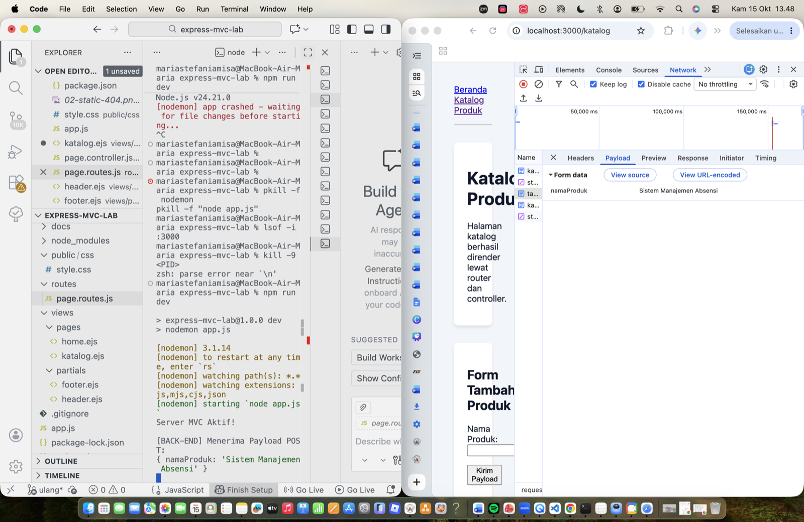

---

## 4. Laboratorium Investigasi Masalah (Troubleshooting)

### Kasus 1: "Cannot read properties of undefined"

- **Pemicu:** baris `app.use(express.urlencoded(...))` dikomentari, lalu form disubmit dan `postTambahProduk` memakai `req.body.namaProduk`.
- **Penyebab:** tanpa middleware parser, Express tidak mengisi `req.body` sehingga bernilai `undefined`. Mengakses properti dari `undefined` menyebabkan server crash.
- **Solusi:** mengaktifkan kembali middleware `express.urlencoded`.

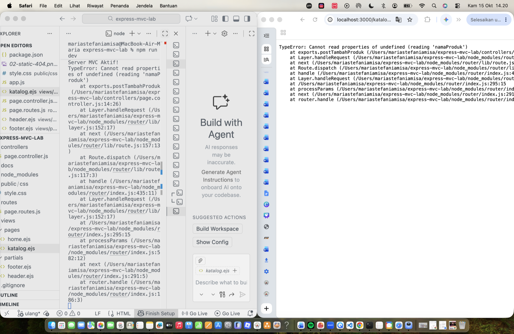

### Kasus 2: "Failed to lookup view"

- **Pemicu:** tujuan render sengaja diubah menjadi `res.render('page/home', ...)` (kurang huruf "s").
- **Penyebab:** Express mencari berkas di folder `views` sesuai path yang diberikan. Karena folder `page` tidak ada, proses render gagal.
- **Solusi:** memperbaiki penulisan menjadi `pages/home`.

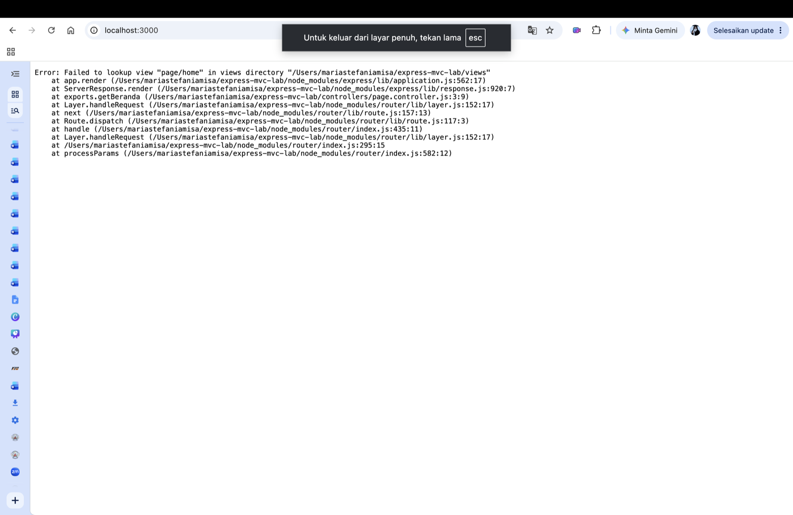

### Kasus 3: "EADDRINUSE: address already in use :::3000"

- **Pemicu:** `node app.js` dijalankan di terminal kedua saat nodemon di terminal pertama masih aktif.
- **Penyebab:** satu port TCP hanya dapat dipakai oleh satu proses, dan port 3000 sudah dipakai oleh nodemon.
- **Solusi:** menghentikan proses di terminal kedua dengan `Ctrl+C`.

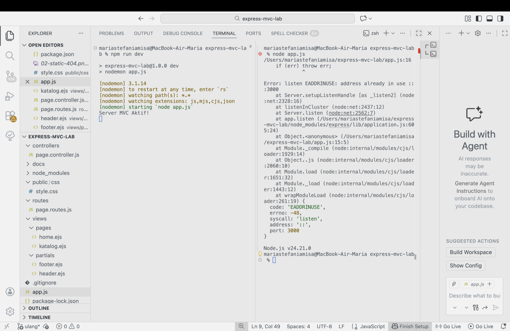

---

## 5. Tugas 2 Terstruktur: Aplikasi Web Perpustakaan Kampus (MVC EJS)

### 5.1 Deskripsi

Aplikasi web multi-halaman bertema **Katalog Perpustakaan**, dibangun dari nol di direktori proyek terpisah (`perpustakaan-mvc`) dengan pola MVC. Data buku disimulasikan memakai array objek di controller.

### 5.2 Struktur Direktori

```
perpustakaan-mvc/
├── app.js
├── package.json
├── public/css/style.css
├── routes/page.routes.js
├── controllers/page.controller.js
└── views/
    ├── pages/        (home, tentang, katalog, tambah)
    └── partials/     (header, footer)
```

### 5.3 Daftar Rute

| Metode | URL | Fungsi Controller | Keterangan |
|---|---|---|---|
| GET | `/` | `getBeranda` | Beranda (data dinamis dari controller) |
| GET | `/tentang` | `getTentang` | Halaman statis |
| GET | `/katalog` | `getKatalog` | Katalog buku, dirender dengan `forEach` |
| GET | `/katalog/tambah` | `getFormTambah` | Form tambah buku |
| POST | `/katalog/tambah` | `postTambahBuku` | Menerima data, `console.log`, redirect (PRG) |

### 5.4 Fitur Form Tambah Buku

Form memiliki empat input dengan tipe berbeda: teks (judul, penulis), angka (tahun terbit), dan dropdown (kategori). Controller membaca `req.body`, mencetaknya ke terminal, menyimpan buku ke array, lalu mengarahkan ke `/katalog` (PRG).

### 5.5 Tampilan Aplikasi

**Beranda**


**Tentang Kami**

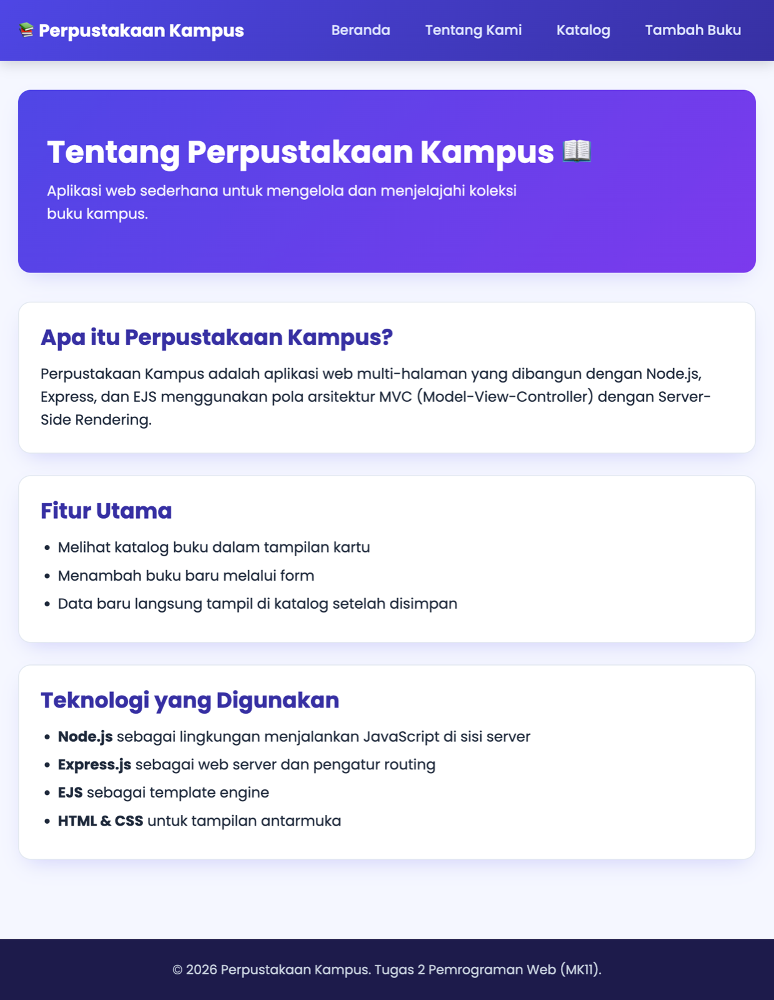

**Katalog Buku**


**Form Tambah Buku**

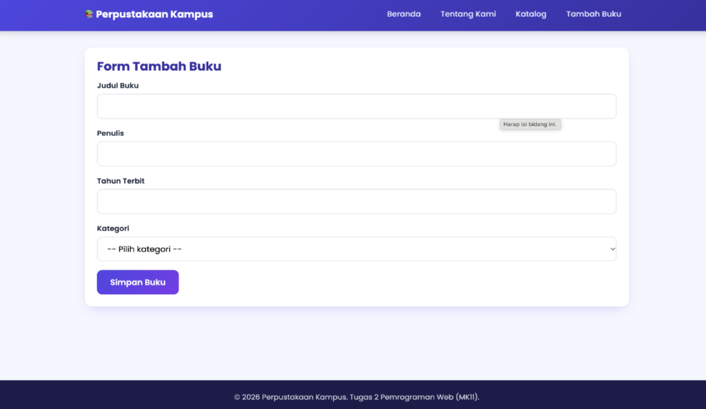

**Terminal menerima payload POST**

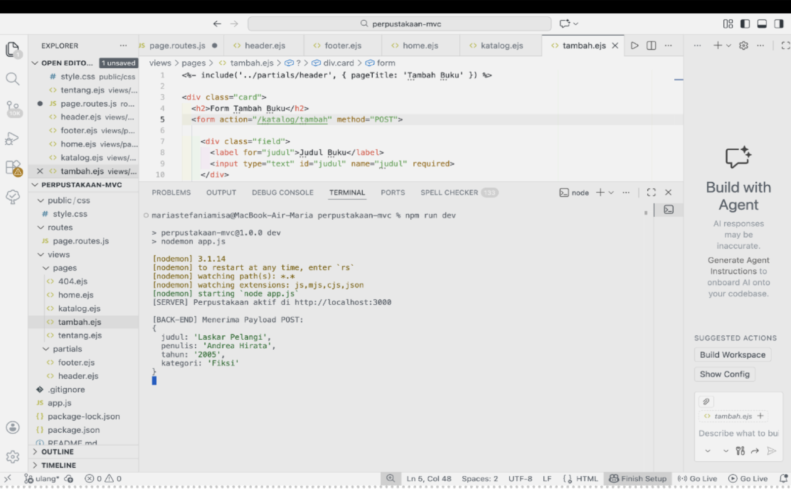

**Katalog setelah buku baru ditambahkan**


### 5.6 Estetika

`style.css` mewarisi reset CSS dan box model (`box-sizing: border-box`) dari Modul 01, lalu ditambah tema warna indigo-ungu, navbar, kartu buku, dan form dengan tampilan responsif.

---

## 6. Kesimpulan

Praktikum ini menunjukkan bagaimana Express.js menangani siklus request-response, bagaimana middleware (static, urlencoded, dan handler 404) diproses berurutan, dan bagaimana EJS menyatukan data dari server dengan template. Pemisahan kode ke dalam routes, controllers, dan views membuat aplikasi lebih rapi dan mudah dikembangkan. Pola PRG mencegah pengiriman ulang data form, dan tiga kasus troubleshooting membantu memahami penyebab galat umum pada aplikasi Express.